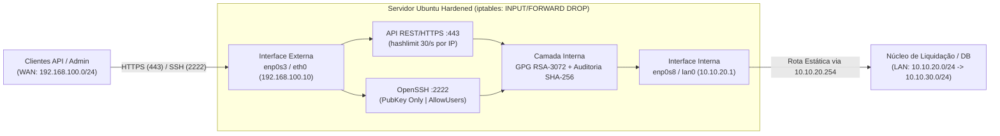
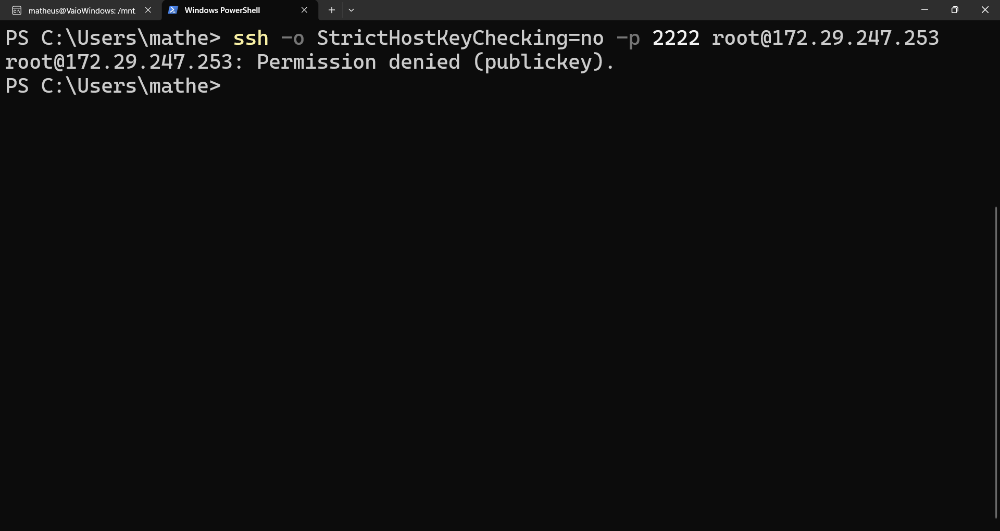
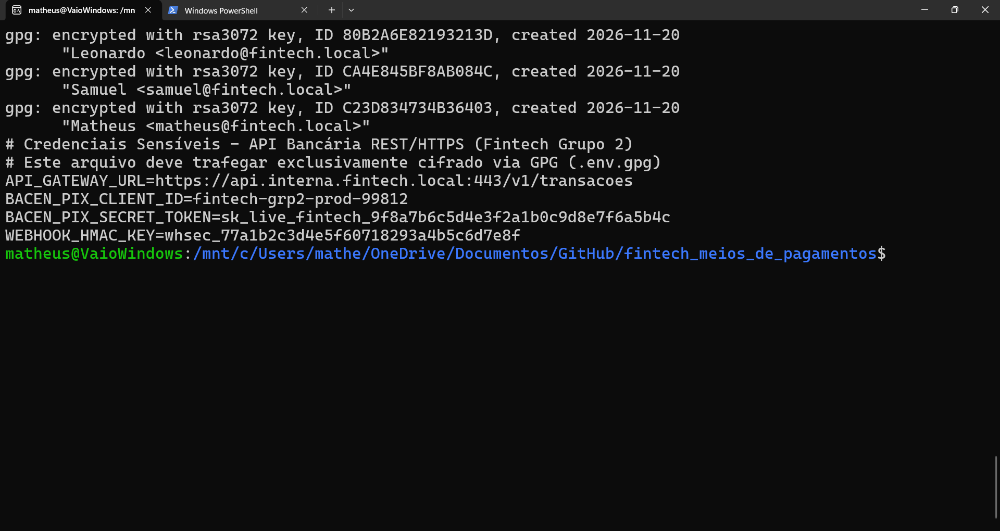
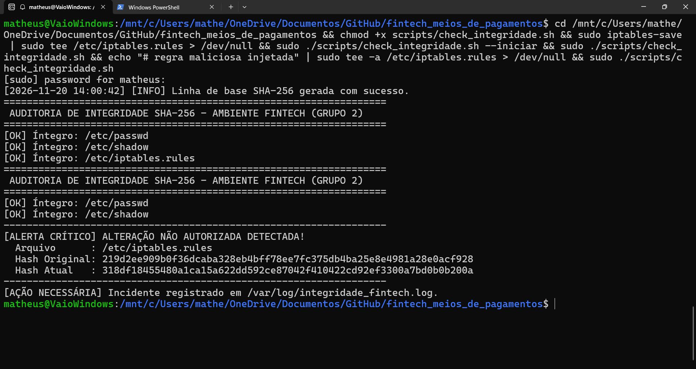

# Segurança da Informação — Infraestrutura Fintech (Grupo 2)

Projeto prático de reformulação e blindagem de infraestrutura local em **Ubuntu Server** para uma organização do setor de **Fintech e Meios de Pagamento**, com foco na proteção de **tráfego de transações bancárias (APIs REST/HTTPS), alta disponibilidade e prevenção contra fraude**.

## Integrantes (Grupo 2)

* **Matheus Felipe Bastos Pereira** (`matheus@fintech.local`)
* **Samuel Antunes de Oliveira Gomes** (`samuel@fintech.local`)
* **Leonardo da Silva Matos** (`leonardo@fintech.local`)

## Arquitetura da Solução

A infraestrutura garante os pilares de **Confidencialidade, Integridade e Disponibilidade (CID)** por meio de quatro camadas:
1. **Segurança Perimetral (`scripts/firewall.sh`):** Filtragem de pacotes via `iptables` com política padrão `DROP`, liberação restrita para tráfego HTTPS (443/TCP) e SSH administrativo (2222/TCP), proteção contra *port scanning* e *rate-limiting* contra DoS/força bruta.
2. **Hardening do Sistema (`configs/sshd_config` e `scripts/hardening.sh`):** Alteração da porta padrão do SSH para `2222`, bloqueio de login `root`, autenticação exclusiva por chaves assimétricas, restrição de usuários (`AllowUsers matheus samuel leonardo`) e ajuste de permissões em `/etc/` e `/var/log/`.
3. **Comunicação Segura (`gpg/`):** Criptografia assimétrica com chaves GPG RSA-3072 assinadas pela equipe para troca segura de tokens e credenciais da API bancária.
4. **Auditoria de Integridade (`scripts/check_integridade.sh`):** Monitoramento contínuo via hashes `SHA-256` dos arquivos `/etc/passwd`, `/etc/shadow` e das regras ativas do `iptables`.



## Estrutura do Repositório

* `docs/` — Relatório Técnico Unificado (`Relatorio_Tecnico_Fintech_Grupo2.pdf`) contendo análise de ameaças (NIC.br / CrowdStrike 2026), PSI, diagrama de topologia e detalhamento técnico.
* `configs/` — Arquivos de configuração de rede estática (`00-netplan-static.yaml`) e do serviço SSH (`sshd_config`).
* `scripts/` — Scripts Shell autorais para firewall (`firewall.sh`), hardening do SO (`hardening.sh`) e auditoria (`check_integridade.sh`).
* `gpg/` — Chave pública exportada da equipe (`chave_publica_grupo2.asc`) e arquivo de credenciais da API cifrado (`api_tokens.env.gpg`).
* `evidencias/` — Capturas de tela dos testes de validação (Nmap, SSH, GPG e alerta de integridade).

## Como Configurar e Executar

> **Pré-requisitos:** Ubuntu Server (VM dedicada ou WSL2), privilégios de superusuário (`sudo`) e pacotes `iptables`, `gnupg`, `openssh-server` e `nmap` instalados.

1. **Configurar interfaces de rede estáticas (apenas em VM dedicada — não executar no WSL2):**
   ```bash
   # Confira os nomes das interfaces antes com: ip a
   sudo cp configs/00-netplan-static.yaml /etc/netplan/
   sudo chmod 600 /etc/netplan/00-netplan-static.yaml
   sudo netplan apply
   ```

2. **Garantir usuários autorizados e aplicar hardening do SO e SSH:**
   ```bash
   # Cria os usuários da equipe caso ainda não existam no servidor
   for u in matheus samuel leonardo; do id "$u" &>/dev/null || sudo adduser --disabled-password --gecos "" "$u"; done

   sudo cp configs/sshd_config /etc/ssh/sshd_config
   sudo chmod +x scripts/hardening.sh && sudo ./scripts/hardening.sh
   sudo sshd -t && sudo systemctl daemon-reload && sudo systemctl restart ssh
   ```

3. **Ativar firewall perimetral (`iptables`):**
   ```bash
   sudo chmod +x scripts/firewall.sh && sudo ./scripts/firewall.sh
   ```

4. **Gerar linha de base de integridade (`SHA-256`) após ativar o firewall:**
   ```bash
   sudo chmod +x scripts/check_integridade.sh
   sudo ./scripts/check_integridade.sh --iniciar
   sudo ./scripts/check_integridade.sh
   ```

## Roteiro de Testes Práticos (Validação)

* **1. Varredura de Portas (Nmap — executado de uma máquina cliente):**
  ```bash
  nmap -sS -Pn -p 22,80,443,2222,5432 <IP_DO_SERVIDOR>
  ```
* **2. Bloqueio de `root` e autenticação por senha no SSH (porta `2222`):**
  ```bash
  ssh -o StrictHostKeyChecking=no -p 2222 root@<IP_DO_SERVIDOR>
  # Resultado esperado: Permission denied (publickey)
  ```
* **3. Criptografia e decifragem de credenciais da API (GPG):**
  ```bash
  gpg --import gpg/chave_publica_grupo2.asc
  gpg --decrypt gpg/api_tokens.env.gpg
  ```
* **4. Detecção de alteração não autorizada (Auditoria SHA-256):**
  ```bash
  echo "# teste violacao" | sudo tee -a /etc/iptables.rules
  sudo ./scripts/check_integridade.sh
  # Para restaurar após o teste:
  sudo sed -i '/# teste violacao/d' /etc/iptables.rules && sudo ./scripts/check_integridade.sh --iniciar
  ```

## Evidências de Validação

### 1. Varredura de Portas (Nmap — Antes e Depois do Firewall)
* **Antes (porta `80/tcp` HTTP exposta):**
  
* **Depois (apenas portas `443/tcp` e `2222/tcp` abertas; demais `filtered`):**
  

### 2. Bloqueio de Acesso `root` via SSH (Porta 2222)


### 3. Criptografia e Decifragem Multi-Membro (GPG RSA-3072)


### 4. Detecção de Violação de Integridade (Alerta SHA-256)

