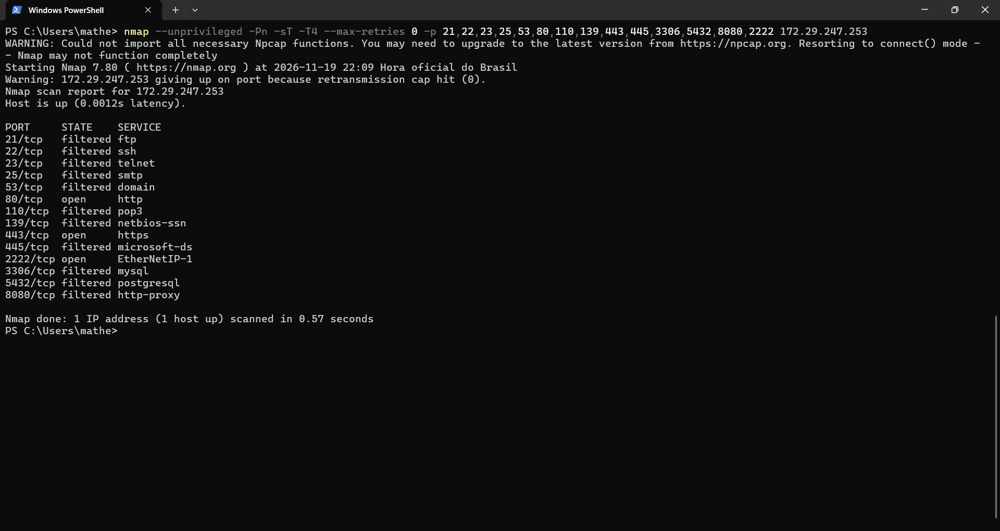

# Segurança da Informação — Infraestrutura Fintech (Grupo 2)

Projeto prático de reformulação e blindagem de infraestrutura local em **Ubuntu Server** para uma organização do setor de **Fintech e Meios de Pagamento**, com foco na proteção de **tráfego de transações bancárias (APIs REST/HTTPS), alta disponibilidade e prevenção contra fraude**.

## Integrantes (Grupo 2)

* **Matheus** (`matheus@fintech.local`)
* **Samuel** (`samuel@fintech.local`)
* **Leonardo** (`leonardo@fintech.local`)

## Arquitetura da Solução

A infraestrutura garante os pilares de **Confidencialidade, Integridade e Disponibilidade (CID)** por meio de quatro camadas:
1. **Segurança Perimetral (`scripts/firewall.sh`):** Filtragem de pacotes via `iptables` com política padrão `DROP`, liberação restrita para tráfego HTTPS (443/TCP) e SSH administrativo (2222/TCP), proteção contra *port scanning* e *rate-limiting* contra DoS/força bruta.
2. **Hardening do Sistema (`configs/sshd_config` e `scripts/hardening.sh`):** Alteração da porta padrão do SSH para `2222`, bloqueio de login `root`, autenticação exclusiva por chaves assimétricas, restrição de usuários (`AllowUsers matheus samuel leonardo`) e ajuste de permissões em `/etc/` e `/var/log/`.
3. **Comunicação Segura (`gpg/`):** Criptografia assimétrica com chaves GPG RSA-3072 assinadas pela equipe para troca segura de tokens e credenciais da API bancária.
4. **Auditoria de Integridade (`scripts/check_integridade.sh`):** Monitoramento contínuo via hashes `SHA-256` dos arquivos `/etc/passwd`, `/etc/shadow` e das regras ativas do `iptables`.

## Estrutura do Repositório

* `docs/` — Relatório Técnico Unificado (PDF), análise de ameaças (NIC.br / CrowdStrike 2026), PSI e diagrama de topologia de rede.
* `configs/` — Arquivos de configuração de rede estática (Netplan) e do serviço SSH (`sshd_config`).
* `scripts/` — Scripts Shell autorais para firewall, hardening do SO e auditoria SHA-256.
* `gpg/` — Chave pública exportada da equipe (`chave_publica_grupo2.asc`) e arquivo de credenciais da API cifrado (`api_tokens.env.gpg`).
* `evidencias/` — Capturas de tela dos testes de validação (Nmap, SSH, GPG e alerta de integridade).

## Como Configurar e Executar

> **Pré-requisitos:** Ubuntu Server com interfaces de rede configuradas, privilégios de superusuário (`sudo`) e pacotes `iptables`, `gnupg` e `openssh-server` instalados.

1. **Configurar interfaces de rede (WAN/LAN):**
   ```bash
   sudo cp configs/00-netplan-static.yaml /etc/netplan/
   sudo netplan apply
   ```

2. **Aplicar endurecimento (hardening) do SO e SSH:**
   ```bash
   sudo cp configs/sshd_config /etc/ssh/sshd_config
   sudo chmod +x scripts/hardening.sh && sudo ./scripts/hardening.sh
   sudo systemctl restart ssh
   ```

3. **Ativar firewall perimetral (`iptables`):**
   ```bash
   sudo chmod +x scripts/firewall.sh && sudo ./scripts/firewall.sh
   ```

4. **Verificar integridade dos arquivos críticos (`SHA-256`):**
   ```bash
   sudo chmod +x scripts/check_integridade.sh
   sudo ./scripts/check_integridade.sh --iniciar
   sudo ./scripts/check_integridade.sh
   ```

## Evidências de Validação

### 1. Varredura de Portas (Nmap — Antes e Depois do Firewall)
* **Antes (porta `80/tcp` HTTP exposta):**
  
* **Depois (apenas portas `443/tcp` e `2222/tcp` abertas; demais `filtered`):**
  

### 2. Bloqueio de Acesso `root` via SSH (Porta 2222)


### 3. Criptografia e Decifragem Multi-Membro (GPG RSA-3072)


### 4. Detecção de Violação de Integridade (Alerta SHA-256)
